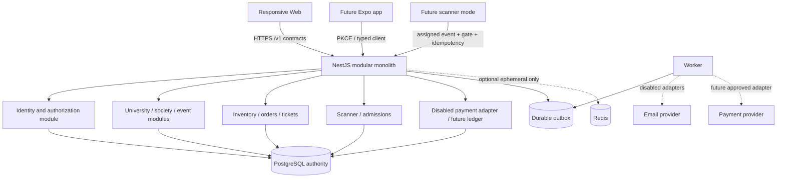
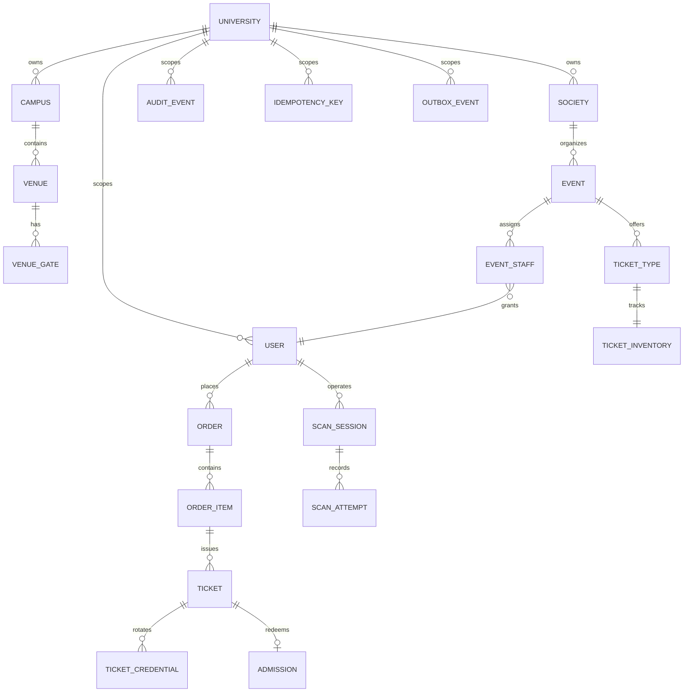

# Architecture overview

## Decisions

- Modular monolith: Next.js web, NestJS API, worker process, shared TypeScript packages.
- PostgreSQL is authoritative. Redis may later accelerate queues/TTL but never decides inventory or ticket state.
- Prisma manages schema/client; transaction-critical paths use explicit SQL/conditional updates where Prisma abstractions are insufficient.
- Web sessions use random opaque tokens stored as hashes, secure HttpOnly cookies, session-bound CSRF tokens, database-backed RBAC, and privileged-role TOTP MFA. Caller-controlled development authentication has been removed.
- Paid tickets, refunds, transfers, and offline scanning are feature-flagged off.

## Component diagram

## Core ERD (Sprint 0)

## Authorization boundary

All private resource queries require an actor and server-derived tenant scope. A nested ID is never authorized merely because the client supplies a matching tenant header. Cross-tenant missing and forbidden resources return the same `RESOURCE_NOT_FOUND` response except where a platform administrator has an audited global scope.

## Transaction patterns

Inventory: serializable transaction → validate event/tier/user policy → conditional inventory update → issue → outbox/audit → commit. Admission: hash credential → verify assignment/event/gate → conditional update `ACTIVE` ticket → admission/attempt/audit → commit. Idempotency records bind actor, scope, operation, and request hash to an order reference. Raw bearer credentials are hashed for scanning and encrypted with AES-256-GCM for authorized wallet replay; the encryption key must come from environment secret management.

## Rollback

Feature flags stop new writes. Additive migrations roll back by disabling consumers first, exporting affected rows, and applying reviewed down SQL only in non-production. Financial/admission history is corrected with compensating records, never destructive mutation.
