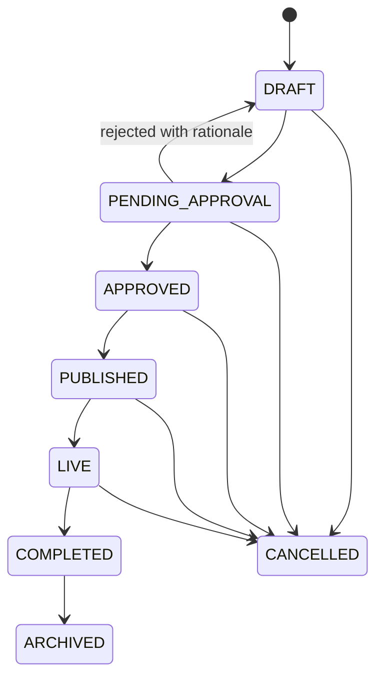
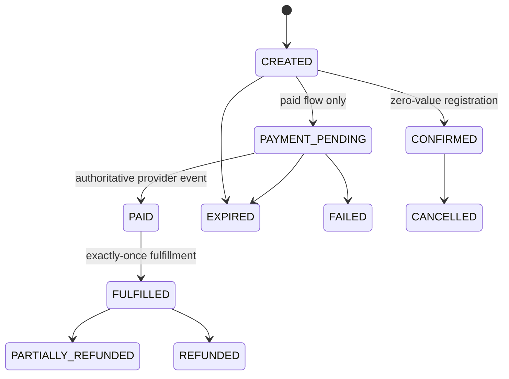
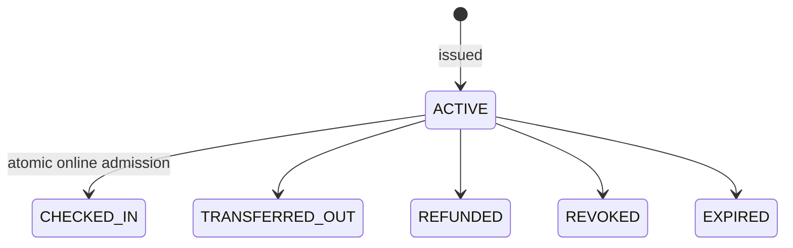

# State-machine baseline

Owner: principal architect. These are target domain transitions; Sprint 0 implements only the bold trust-critical subset described in the delivery status.

Holds, refunds, transfers, and waitlists remain planned. Their transition rules must be finalized before their migrations are introduced; no future state is marked implemented by this document.
